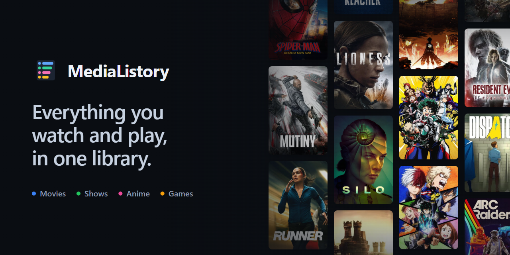
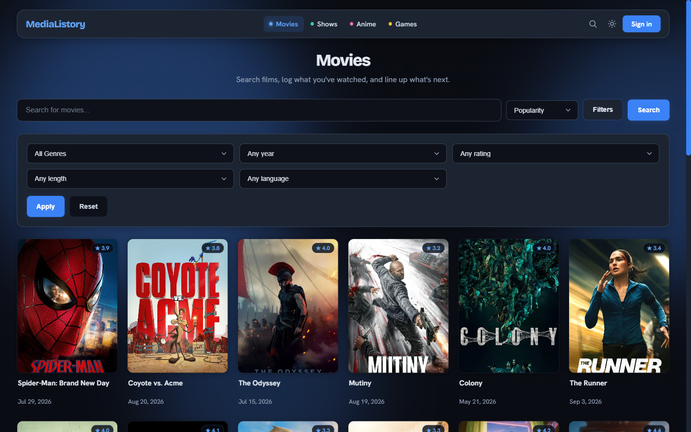
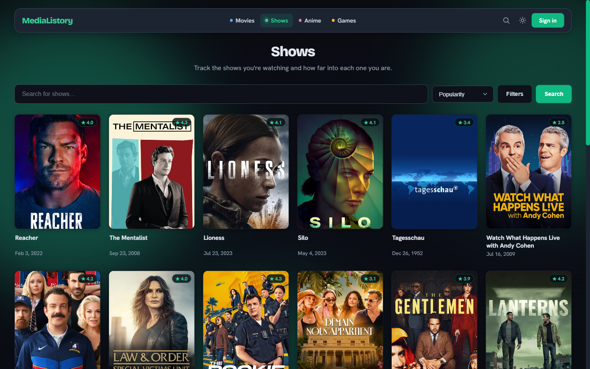
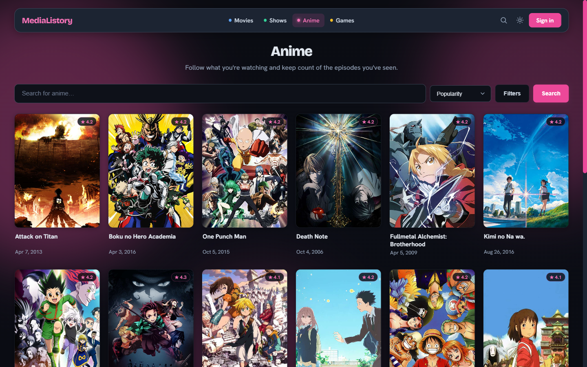
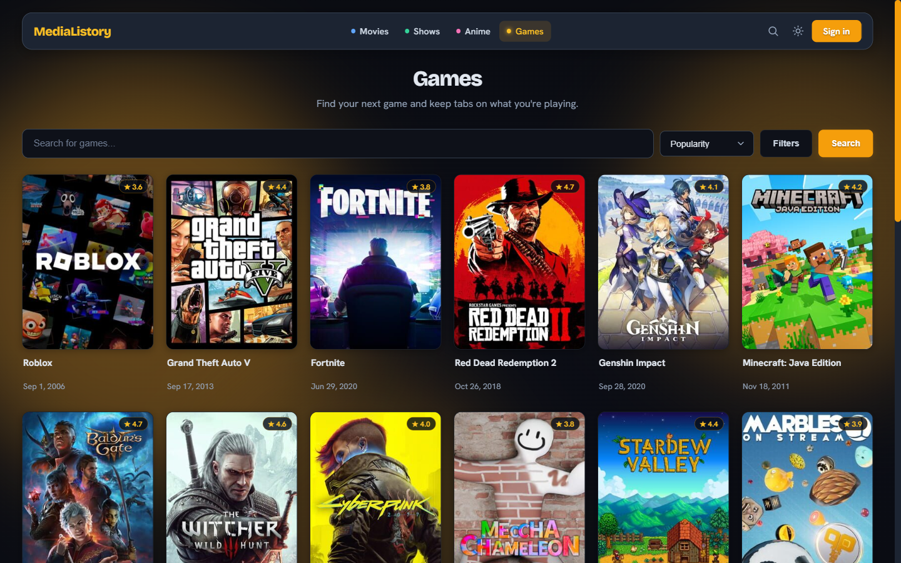
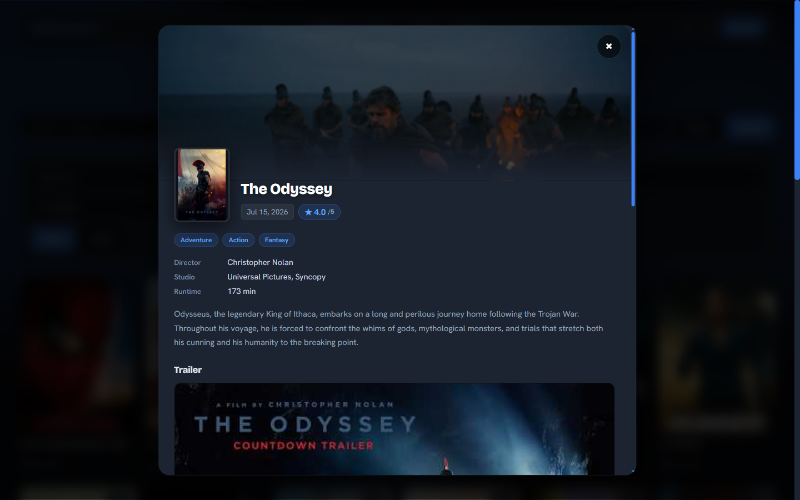
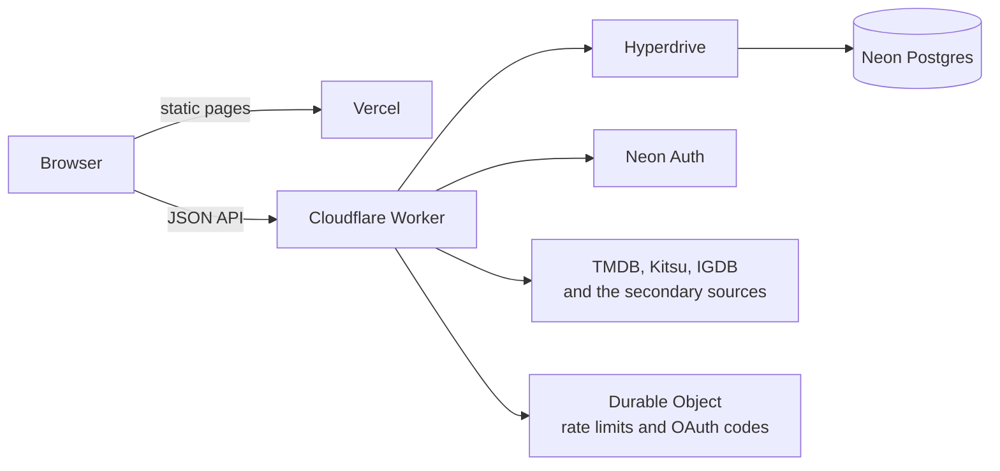

<p align="center">
  
</p>

<h1 align="center">MediaListory</h1>

<p align="center">
  One library for the movies, shows, anime, and games you keep track of.<br>
  <a href="https://medialistory.vercel.app"><b>medialistory.vercel.app</b></a>
</p>

<p align="center">
  <a href="https://github.com/Gr33nOps/medialistory/actions/workflows/ci.yml"></a>
  <a href="LICENSE"></a>
  
  
  
</p>



MediaListory started as a game tracker and grew into one place for everything I watch and play. Movies, shows, anime, and games share a library, a rating scale, lists, and a profile, while each category keeps the browse filters and detail pages its data source supports.

You can browse without an account. Sign in when you want to save something.

## The four categories

|  |  |
|:--:|:--:|
| **Movies** (TMDB) | **Shows** (TMDB) |
|  |  |
| **Anime** (Kitsu) | **Games** (IGDB) |

Every category shares one layout and one library. Each has its own accent color and only offers the filters its provider supports: genre, year, rating, and language for movies and shows; season, format, and age rating for anime; platform and game mode for games. Search and filters run against the provider, not against whatever page happens to be loaded, so an exact title match comes back first.

A title page puts the poster beside the genres, credits, and synopsis, with the trailer, where to watch, and related titles below.



## What it does

- **Track anything.** Mark a title planned, in progress, completed, on hold, or dropped. Add a score out of ten and an optional review.
- **Follow progress.** Shows and anime keep episode counts with a one-tap +1. Seasons can be rated separately and roll up into the overall score, and an anime franchise appears as one entry.
- **Lists.** Custom lists can mix all four categories.
- **Find things.** Search every category from the nav, with `/` or `Ctrl+K` to jump in.
- **Bring your history.** Import a Letterboxd, MyAnimeList, or Trakt CSV, or a MediaListory JSON export. Every row shows its match before anything is saved. Export one category or the whole library.
- **Profiles.** Rank a Top 10 in each category, pin what you are in the middle of, and keep the profile public or private with follow requests.
- **People.** Follow others, read a feed of what they finished or rated, see a Similar Taste percentage worked out from shared titles, scores, Top 10s, and genres, and compare two libraries side by side.
- **Extra detail.** Depending on the title: best current game price (CheapShark), MyAnimeList score and opening and ending themes (Jikan, AnimeThemes), and upcoming episode dates (TVmaze).
- **Sign-in.** Email and password, Google, or GitHub. Light and dark themes, on desktop and phone.

## How it is built



| Layer | Choice |
|---|---|
| Frontend | Plain HTML, CSS, and JavaScript served as static files by Vercel. No framework, no bundler. |
| API | Cloudflare Workers. Route modules live in `Backend/`, the Worker entry is `worker/index.js`. |
| Database | Neon Postgres through Hyperdrive, queried with Knex. |
| Identity | Neon Auth for email and password. Google and GitHub sign-in is a direct OAuth2 code exchange on the API. |
| Catalogs | TMDB (movies, shows), Kitsu (anime), IGDB (games). |
| Checks | `node:test`, the Worker running on local workerd, Playwright, and a Semgrep scan in CI. |

A few decisions worth knowing about:

- **Catalog on demand, with a fallback.** The API queries the providers per request and writes what it sees to a `games` table (despite the name, it holds every media type). If a provider is down, browse serves the stored rows and says so in an `X-Cache: DEGRADED` header.
- **One set of handlers, two runtimes.** The route modules run on Workers and on a legacy Express server through a small Express-compatible router (`Backend/http/router.js`). The Worker adds what Express middleware used to do: CORS, security headers, rate limits, body parsing.
- **Fresh reads after writes.** Hyperdrive query caching is off, because the app lists your library right after you add to it. Each request gets its own Knex connection.
- **Limits that hold across instances.** The auth limit (40 requests per 15 minutes per IP) lives in a Durable Object so it is exact. The catalog limit (60 per minute) uses the Workers Rate Limiting binding.
- **Sessions.** HS256 JWTs verified with `jose`, sent as a Bearer token because the API is on a different site from the frontend. OAuth returns to the frontend with a one-time code held in a Durable Object.

The migration from a Node server to Workers, including the full route inventory, is written up in [docs/cloudflare-migration.md](docs/cloudflare-migration.md).

## Run it yourself

You need Node.js 22 or newer, a Neon database (a branch is best for local work), and API keys for the providers you use: TMDB, and a Twitch client ID and secret for IGDB. Kitsu needs no key.

```bash
git clone https://github.com/Gr33nOps/medialistory.git
cd medialistory
npm install
cp .dev.vars.example .dev.vars
```

1. Fill in `.dev.vars`. Every variable is explained in [docs/cloudflare-workers.md](docs/cloudflare-workers.md).
2. Apply [`DB/schema.postgres.sql`](DB/schema.postgres.sql) to your Neon branch, then the files in [`DB/migrations/`](DB/migrations/) in order. [`DB/README.md`](DB/README.md) has the details.
3. Point local Hyperdrive at that branch and start the Worker:

```bash
export CLOUDFLARE_HYPERDRIVE_LOCAL_CONNECTION_STRING_HYPERDRIVE="postgres://..."
npm run dev:worker
```

Open [localhost:8787](http://localhost:8787). In local development the Worker serves the API and the `Frontend/` folder together.

| Command | What it does |
|---|---|
| `npm run dev:worker` | Run the API and the frontend locally |
| `npm test` | Unit and smoke tests |
| `npm run test:worker` | Run the Worker on local workerd: health probes, CORS, headers, rate limits |
| `npm run test:e2e` | Playwright end-to-end suite |
| `npm run deploy:staging`, `npm run deploy:production` | Deploy the Worker |
| `npm start` | The legacy Express server, same handlers |

Deploying, secrets, and the environment-variable reference are in [docs/cloudflare-workers.md](docs/cloudflare-workers.md).

## Testing and CI

Every push and pull request runs the unit and smoke tests, bundles the Worker, runs the Worker tests on workerd, and runs Semgrep with `--error` on any warning or error. Verified false positives carry an inline `nosemgrep` comment that says why. The Playwright suite runs daily against the live site. Merges to `main` that touch backend code deploy the Worker after the tests pass. Dependabot keeps dependencies and GitHub Actions current.

## Project layout

```text
Backend/    Route modules, provider proxies, auth, shared middleware
worker/     Cloudflare Worker entry, request adapter, database and Durable Object glue
Frontend/   Static pages, CSS, and JavaScript
DB/         Schema, migrations, and the archived MySQL dump
docs/       API contracts, OpenAPI spec, runbook, Workers guide, migration notes
test/       unit, smoke, worker (workerd), deployed (smoke test for a live API), e2e
.github/    CI, deploy workflow, issue and pull request templates
```

Reference: [API contracts](docs/API.md), [OpenAPI spec](docs/openapi.yaml), [runbook](docs/runbook.md).

## Contributing

Issues and pull requests are welcome. [CONTRIBUTING.md](CONTRIBUTING.md) covers setup and what CI checks. Report security problems privately, as described in [SECURITY.md](SECURITY.md). The [Code of Conduct](CODE_OF_CONDUCT.md) applies to everyone.

MediaListory is free and has no ads. If you find it useful, there is an optional [Ko-fi](https://ko-fi.com/zain021xd) and [GitHub Sponsors](https://github.com/sponsors/Gr33nOps).

## Credits and data

Movie and show data comes from [TMDB](https://www.themoviedb.org/), anime from [Kitsu](https://kitsu.io/), and games from [IGDB](https://www.igdb.com/), a Twitch service. Detail pages also use [CheapShark](https://www.cheapshark.com/), [Jikan](https://jikan.moe/) (MyAnimeList data), [AnimeThemes](https://animethemes.moe/), and [TVmaze](https://www.tvmaze.com/), whose data is used under [CC BY-SA](https://creativecommons.org/licenses/by-sa/4.0/).

MediaListory is not endorsed or certified by any of these services. Posters, titles, and descriptions belong to their owners.

## License

[MIT](LICENSE) © Gr33nOps
